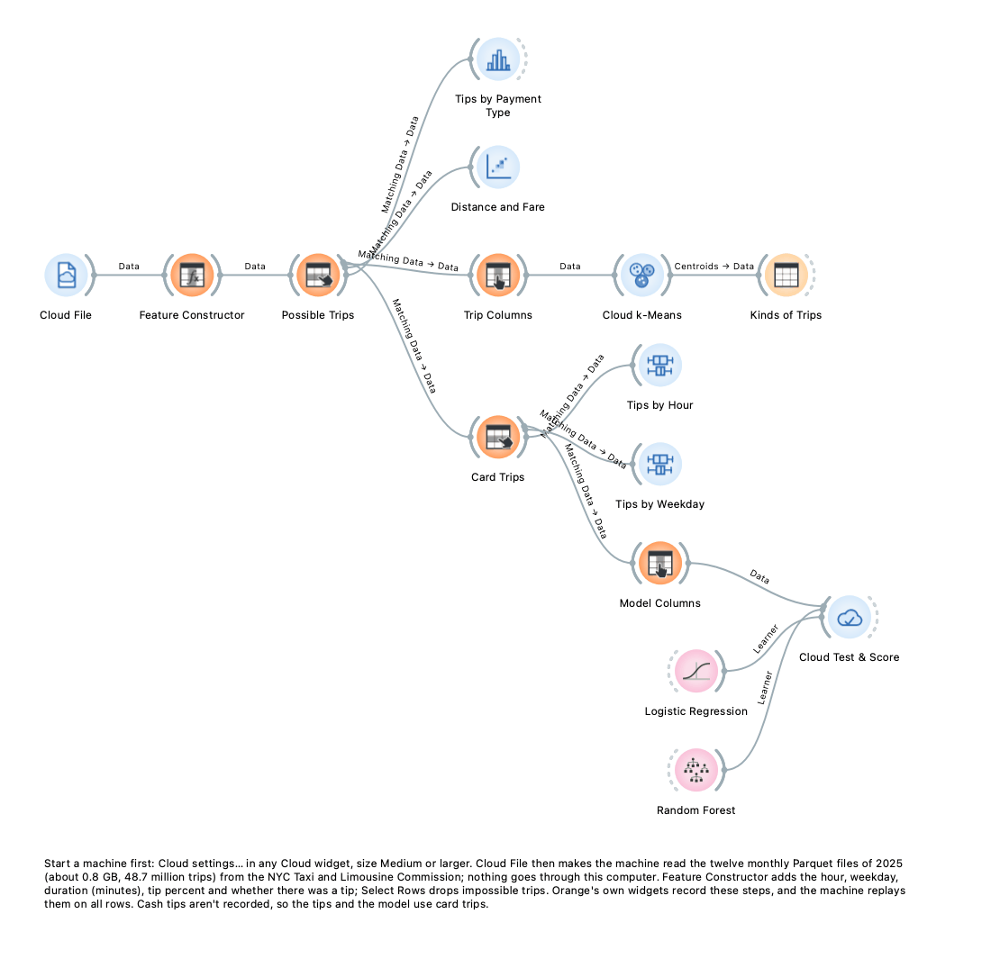
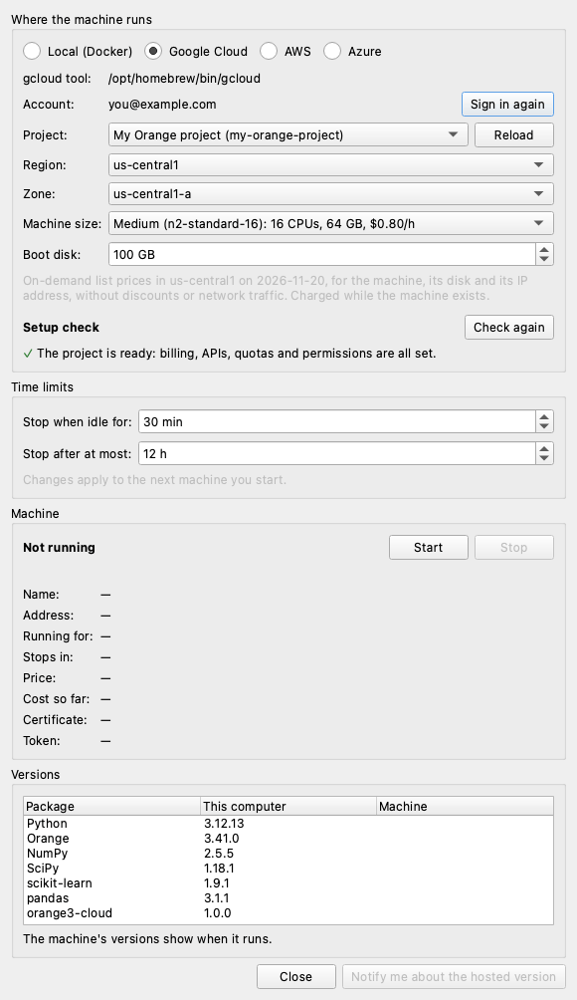
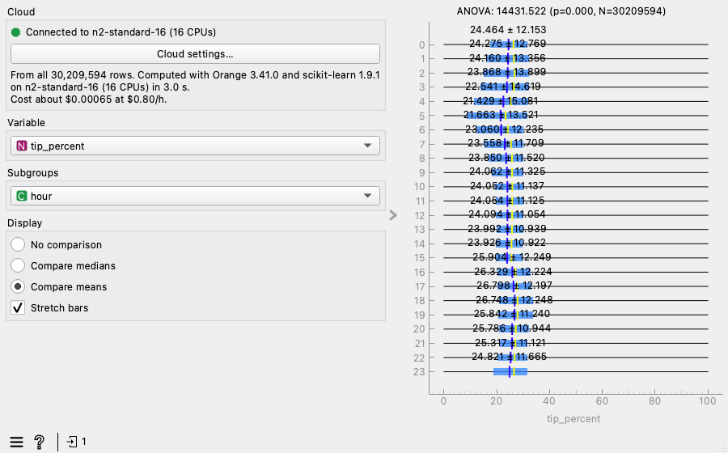

# orange3-cloud

An add-on for [Orange Data Mining](https://orangedatamining.com) that runs heavy computation on a machine in your own cloud account: Google Cloud, AWS or Azure.

You build workflows in Orange on your own computer as usual. Data that is too large for your laptop, and slow work such as cross-validation, runs on a cloud machine instead. The add-on starts the machine for you, keeps your data there, and stops the machine when it is idle. You pay your cloud provider directly for what you use, usually cents per run.

- **Your data stays in the cloud.** Cloud File loads CSV or Parquet files into the machine's memory, from your computer, a URL or your cloud's storage (Google Cloud Storage, Amazon S3 or Azure Blob Storage). Orange on your laptop holds only a reference to the data.
- **Every result comes from all rows.** The Cloud widgets compute on the machine, on the whole table, never on a sample.
- **Orange's own widgets still work.** Select Columns, Select Rows, Feature Constructor and other data widgets record their steps, and the machine replays them on all rows. Learners come from Orange's learner widgets, and results go to Orange's ROC Analysis, Confusion Matrix and others.
- **Your account, your machine.** Nothing goes through anyone else's servers. The machine copies your exact versions of Python, Orange and your add-ons.

## Requirements

- **Orange 3** on **Python 3.10 or newer**. Every Orange from 3.39 on meets this. Older Orange versions on Python 3.9 can't install the add-on.
- **macOS on Apple Silicon.** This is the platform that is tested. Windows and Linux should work, since the add-on is pure Python, but they aren't tested. Intel Macs aren't supported in 1.0.
- **An account on one of three clouds,** with billing set up, and that cloud's **command-line tool** for signing in: a Google Cloud project and Google's `gcloud`, an AWS account and the AWS CLI, or an Azure subscription and the Azure CLI. Each has a setup guide; "[Choose a cloud](#choose-a-cloud)" below links them.
- Optional: **Docker Desktop** or **OrbStack** to run the machine on your own computer instead ("local mode"), for trying the add-on without a cloud account.

## Install

1. In Orange, open **Options → Add-ons…**.
2. Click **Add more…**, type `orange3-cloud` and click **Add**.
3. Make sure **Cloud** is checked, click **OK**, and restart Orange when it asks.

The toolbox now has a **Cloud** section.

## Choose a cloud

The add-on works the same way on Google Cloud, AWS and Azure: the same machine sizes and the same widgets. Cloud settings has a page for each, and you can switch between them whenever no machine is running. Setting up a cloud takes about 15 minutes, and Orange checks the account for you and says what is still missing. Each cloud has its own setup guide:

- [Google Cloud](docs/setup-gcp.md)
- [AWS](docs/setup-aws.md)
- [Azure](docs/setup-azure.md)

**New accounts often can't run Medium yet.** Every cloud limits how many vCPUs may run at once, and new accounts often allow fewer than the 16 that Medium needs. Each setup guide says how to ask for more; it often takes minutes, sometimes a day. The free trials of Google Cloud and Azure run only Small: upgrade to a paid account for Medium. Small is enough for the one-month version of the taxi demo below.

## Quick start: a year of New York taxi trips

The [taxi demo](docs/demo-taxi.md) explores and models every yellow taxi trip in New York City in 2025, 48.7 million of them: when people tip and how much, how distance and fare go together, what kinds of trips there are, and whether a trip paid by card gets a tip. On a laptop with 16 GB of memory, Orange runs out of memory before it has loaded the year. On a Medium cloud machine, every view of all 48.7 million trips is ready after about 10 minutes, and the whole workflow, cross-validation included, takes about 45 minutes and costs about $0.60.

1. **Set up your cloud** once: follow steps 1 to 5 of its setup guide (see "[Choose a cloud](#choose-a-cloud)"), up to the setup check in Cloud settings. It takes about 15 minutes. If the check says that your vCPU quota is too low for Medium, request more as the guide explains, or start with Small and the January workflow (step 2).
2. **Open the workflow.** Download [examples/taxi-demo.ows](examples/taxi-demo.ows) ("Download raw file" on GitHub) and open it with **File → Open** in Orange. The Cloud widgets say they aren't connected yet.

   If your account can run only Small for now, open [examples/taxi-demo-january.ows](examples/taxi-demo-january.ows) instead: the same workflow on the 3.5 million trips of January. On a Small machine, it takes about 3 minutes after the machine has started, for about $0.02.

3. **Start a machine.** Double-click Cloud File and click **Cloud settings…** (every Cloud widget has this button). Choose your cloud: **Google Cloud**, **AWS** or **Azure**. Its page shows your sign-in, and the project (Google Cloud), profile (AWS) or subscription (Azure) and the region you chose in its setup guide. Choose the machine size **Medium** (16 vCPUs, 64 GB), or **Small** for January. When the setup check passes, click **Start**. The machine is ready in about two minutes.

   

4. **Let it run.** As soon as the machine is connected, Cloud File makes it read the twelve monthly files from the website of New York City's Taxi and Limousine Commission and load them as one table, in about a minute. Nothing goes through your computer. Orange's own Feature Constructor and Select Rows add the hour, weekday, duration and tip percentage and drop impossible trips; the machine replays their steps on all rows, which takes about 7 minutes. The Cloud viewers, Cloud k-Means and Cloud Test & Score then compute on the result, each on the machine.
5. **Look at the results.** Open **Tips by Hour**, **Distance and Fare** or **Kinds of Trips** to see what all the trips show. Cloud Test & Score cross-validates logistic regression and a random forest on the 30 million card trips in about half an hour. Each Cloud widget shows how long the machine computed and what it cost.

   

6. **Stop the machine** with **Stop** in Cloud settings. If you forget, it stops by itself after 30 minutes without work.

| | Trips | Load | The whole workflow | AUC: logistic regression / forest |
|---|---:|---:|---:|---:|
| Laptop (M1, 16 GB) | January, 3.5 million | 49 s | 3 min 23 s | 0.715 / 0.719 |
| Laptop (M1, 16 GB) | 4 months, 15.2 million | 4 min 20 s | 17 min 11 s (swapping) | 0.711 / 0.715 |
| Laptop (M1, 16 GB) | the year, 48.7 million | out of memory | not possible | – |
| Cloud, Medium | the year, 48.7 million | 47 s | 41 min 55 s | 0.749 / 0.752 |

The cloud machine ran on Google Cloud for 44.5 minutes in all, start included, for about $0.59. [docs/demo-taxi.md](docs/demo-taxi.md) has the details of these timings, what each widget shows, and screenshots.

## Far beyond a laptop: 11 million rows

The [HIGGS demo](docs/demo-higgs.md) cross-validates a random forest and logistic regression on the whole HIGGS dataset: 11 million rows, a 2.6 GB compressed CSV file. On a laptop with 16 GB of memory, Orange runs out of memory before it has even loaded the file. On a Medium cloud machine, the whole workflow takes about 20 minutes and costs about $0.30.

Open [examples/higgs-demo.ows](examples/higgs-demo.ows) as above, and start a Medium machine. Cloud File makes the machine download the HIGGS file from the UCI Machine Learning Repository and load it, which takes about 3 minutes, and Cloud Test & Score cross-validates both learners on all 11 million rows in about 15 minutes. The evaluation results hold a prediction for every row and learner, about 0.7 GB: click **Download results** in Cloud Test & Score and confirm, and ROC Analysis draws both curves.

| | Rows | Load | Cross-validation | AUC: random forest |
|---|---:|---:|---:|---:|
| Laptop (M1, 16 GB) | 1 million | 29 s | 3 min 12 s | 0.769 |
| Laptop (M1, 16 GB) | 4 million | 13 min (swapping) | 15 min 47 s | 0.784 |
| Laptop (M1, 16 GB) | all 11 million | out of memory | not possible | – |
| Cloud, Medium | all 11 million | 3 min 10 s | 15 min 12 s ($0.20) | 0.804 |

[docs/demo-higgs.md](docs/demo-higgs.md) has the details of these timings.

### Try it without a cloud account

With Docker Desktop or OrbStack running, choose **Local (Docker)** in Cloud settings and click **Start**. The machine then runs in Docker on your computer, at no cost. The first start downloads the machine image, Python and your packages, which takes a few minutes; later starts take under a minute. Local mode has only your computer's memory (as much as Docker may use), so it's for trying the add-on and for small data, not for a year of taxi trips or for HIGGS.

## Use it in your own workflows

Start with **Cloud File** and connect its output the way you would connect Orange's File widget:

- **Change the data** with Orange's own widgets: Select Columns, Select Rows, Feature Constructor, Edit Domain (renaming columns, renaming and merging categories), Continuize and Color. Their steps are replayed on all rows on the machine.
- **Steps that learn from the data**, such as normalizing, imputing, discretizing or PCA, go through **Cloud Preprocess**: build the recipe in Orange's Preprocess widget and connect its Preprocessor output to Cloud Preprocess.
- **Learners** come from Orange's learner widgets (Random Forest, Logistic Regression, Tree, kNN, ...). Don't connect data to them; connect their Learner output to a Cloud widget.
- **Look at the data** with the Cloud viewers instead of Orange's Data Table, Feature Statistics, Distributions, Box Plot and Scatter Plot.

| Cloud widget | What it does on the machine |
|---|---|
| Cloud File | Loads a CSV or Parquet file (also `.gz`, and Orange's `.tab` files), or several with the same columns, from your computer, a URL or your cloud's storage (`gs://`, `s3://` or `az://`). |
| Cloud Data Table | Shows the rows a page at a time, sorted on all rows. |
| Cloud Feature Statistics, Cloud Distributions, Cloud Box Plot, Cloud Scatter Plot | Statistics and plots computed on all rows. |
| Cloud Preprocess | Fits a recipe from Orange's Preprocess widget on all rows. |
| Cloud Rank | Scores the features with Orange's Rank methods on all rows, and keeps the best. |
| Cloud Discretize | Discretizes numeric columns with Orange's Discretize methods, cut points found on all rows. |
| Cloud Purge Domain | Removes unused values and constant columns and sorts values, as Orange's Purge Domain, decided on all rows. |
| Cloud Categories | Counts a column's values on all rows, makes a numeric or text column categorical and merges infrequent values, as Orange's Edit Domain. |
| Cloud Create Class | Makes a class column from substrings of a column's values, as Orange's Create Class, on all rows. |
| Cloud Learner | Trains a model. The model stays on the machine and can be downloaded. |
| Cloud Test & Score | Cross-validates learners in parallel, with scores on all rows. |
| Cloud Predictions | Predicts all rows with the models from Cloud Learner. |
| Cloud k-Means, Cloud t-SNE, Cloud MDS | Clustering and embeddings of all rows. |
| Cloud Distances, Cloud Hierarchical Clustering | Distance matrices kept on the machine, and their clustering. |

Each widget's help page (press F1 or click "?" in the widget) explains its options. [docs/supported-widgets.md](docs/supported-widgets.md) lists which of Orange's own 70 widgets work on cloud data, and what to use instead for the ones that don't.

## Costs

You pay your cloud provider directly, at its prices. The add-on itself is free.

- **Machines are billed by the second while they run.** The size list in Cloud settings shows each size's hourly list price in your region, with the boot disk and the machine's IP address included. Each setup guide lists all sizes.
- **You see what you spend.** Each Cloud widget's status line shows what its last job cost, and Cloud settings shows the machine's cost so far. The add-on keeps a record of every machine's cost on your computer, from its start until it was deleted: its full hourly price while it ran and, once it stopped by itself, the price of what stays until Orange deletes it (its disk, and on Azure its IP address). That includes machines that stopped while Orange was closed and machines deleted with "Delete them…". These are estimates from list prices; your cloud's billing has the exact costs.
- **Machines stop by themselves** after 30 minutes without work and after at most 12 hours. You can change both limits in Cloud settings, and **Stop** deletes the machine at once. Quitting Orange cancels the Cloud widgets' jobs. If Orange crashes, can't reach the machine as it quits, or your laptop sleeps, the machine cancels its jobs itself once it hasn't heard from Orange for the idle time, so a job nobody waits for doesn't keep it running until the 12 hours are up.
- **Stop deletes everything the machine used:** the VM, its disk and the network rule that lets your computer reach it. If Orange is closed while a machine runs, the machine still stops after its idle time and its compute costs nothing more, but its disk (and on Azure its IP address) stays, and is billed, until you open Orange again, which deletes it. "Delete them…" in Cloud settings deletes machines left behind.
- **Not included in the estimates:** files you upload stay in the add-on's storage in your account (a Cloud Storage bucket, an S3 bucket or an Azure storage account) for later sessions, and your cloud bills them by the GB and month until you delete them with "Uploaded files…" in Cloud File. Downloads from the cloud to your computer, such as large evaluation results, count as network traffic. Discounts and free tiers aren't included either.
- **Set a budget alert** in your cloud's billing (step 2 of each setup guide). The add-on has no spending limit of its own.

## Security and privacy

- **Everything runs in your own cloud account.** Your data, the machine and the storage for your files are yours. The add-on sends no usage statistics and has no server of its own. Besides your cloud and your machine, it asks only `api.ipify.org` (or `checkip.amazonaws.com`) for your public IP address, for the machine's network rule.
- **Sign-in** uses your cloud's own command-line tool, which keeps the sign-in on your computer: Google's application default credentials from `gcloud`, a profile of the AWS CLI, or the Azure CLI's sign-in. The add-on never sees your password.
- **Each machine has its own random access token** and its own HTTPS certificate, which the add-on creates when it starts the machine. The add-on trusts only that certificate, so nobody can pose as your machine. The token and the certificate are kept in the add-on's private folder on your computer, never in workflow files. People who can manage the machines in your account may be able to read them in the machine's settings.
- **The network rule** `orange3-cloud-https` (a firewall rule on Google Cloud, a security group on AWS, a network security group on Azure) lets only your computer's current public IP address reach the machine, on one port (TCP 8443). The add-on updates it when your address changes.
- **The machine** on Google Cloud runs as your project's default Compute Engine service account, with read-only access to Cloud Storage. On AWS and Azure it has no access to your storage of its own: for each file it loads, the add-on gives it a short-lived, read-only link, signed with your sign-in. On Azure, the machine may deallocate its own VM, so that it stops costing compute when it stops, and nothing else. Its machine image is public, and at boot it installs your exact package versions from the Python Package Index.
- **The storage for your files** is private: the Cloud Storage bucket has uniform access and public access prevention on, the S3 bucket blocks all public access, and the Azure storage account has public access and account keys off.
- **Workflow files (`.ows`) contain no connection settings or credentials,** so you can share them. They do contain file paths and URLs that Cloud File loads.

## Supported platforms

| Platform | Status in 1.0 |
|---|---|
| macOS on Apple Silicon | supported and tested |
| Windows, Linux | should work, not tested |
| Intel Macs | not supported |
| Orange | 3.x on Python 3.10 or newer (every Orange from 3.39 on) |
| Cloud | Google Cloud, AWS or Azure; one machine at a time, x86-64 machines without GPUs |

## Known limits

- **Data-changing widgets that learn from the data** (Normalize in Continuize or Preprocess, Impute, Discretize, PCA, ...) are refused on cloud data: use Cloud Preprocess instead. Orange's Rank, Discretize and Purge Domain stop with an error in their usual settings and give results that differ from Orange's on all rows in others: use Cloud Rank, Cloud Discretize and Cloud Purge Domain instead. Create Class is refused (use Cloud Create Class); Edit Domain's "As categorical" is refused and its "Merge infrequent" merges nothing on cloud data (use Cloud Categories for both). [docs/supported-widgets.md](docs/supported-widgets.md) has the full list.
- **Files:** CSV (with a header row, without one, or with Orange's three header rows), Orange's `.tab`, and Parquet, optionally gzipped. Files with rows of different lengths, files that aren't UTF-8, and Orange's one-row `c#name` headers aren't supported. Instance weights aren't supported: a weight column is skipped with a warning.
- **The machine copies your environment.** Orange, your add-ons and the packages they need must be installable from the Python Package Index at your exact versions. Packages installed from a local folder can't be copied; Cloud settings lists them.
- **One machine at a time.** No GPUs or ARM machines.

## Roadmap

What may come next is in the [roadmap issues](https://github.com/ggaammdev/orange3-cloud/issues?q=label%3Aroadmap): Windows, Linux and Intel Macs, ARM, Spot and GPU machines, signing in from Orange, more widgets, budget limits and a hosted service. Add a thumbs-up to the ones you want most, or comment with how you'd use them: that helps decide what comes first.

## Help and feedback

- [docs/setup-gcp.md](docs/setup-gcp.md), [docs/setup-aws.md](docs/setup-aws.md) and [docs/setup-azure.md](docs/setup-azure.md): setting up Google Cloud, AWS or Azure, and troubleshooting.
- [docs/demo-taxi.md](docs/demo-taxi.md): the NYC taxi demo, its timings and screenshots.
- [docs/demo-higgs.md](docs/demo-higgs.md): the HIGGS demo and its timings.
- [docs/supported-widgets.md](docs/supported-widgets.md): Orange's widgets on cloud data.
- Report problems and ideas in the GitHub issues of [ggaammdev/orange3-cloud](https://github.com/ggaammdev/orange3-cloud/issues).
- Report security problems privately, not in an issue: [SECURITY.md](SECURITY.md) says how.

## Development

[docs/dev.md](docs/dev.md) has the development setup, local mode from a source checkout, the tests and how everything works. [AGENTS.md](AGENTS.md) has the layout, the commands and the architecture rules, for people and for coding agents.

Contributions are welcome: [CONTRIBUTING.md](CONTRIBUTING.md) says how. [CHANGELOG.md](CHANGELOG.md) lists the changes in each release.

## License

GPL-3.0-or-later, the same as Orange. See [LICENSE](LICENSE).
