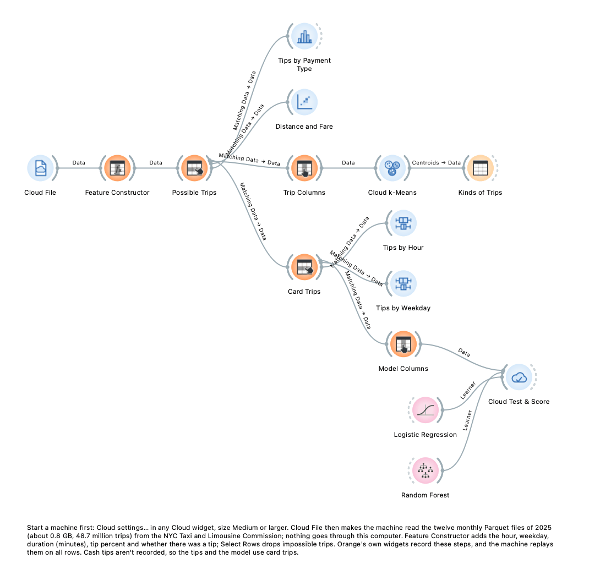
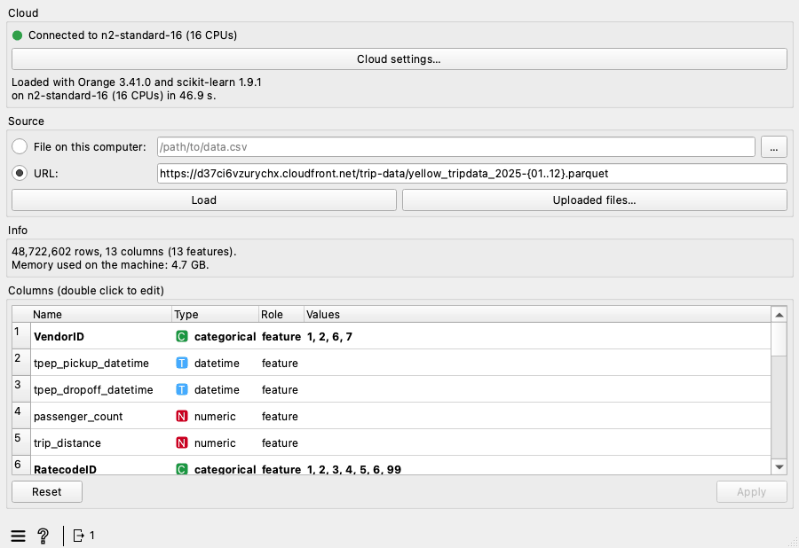
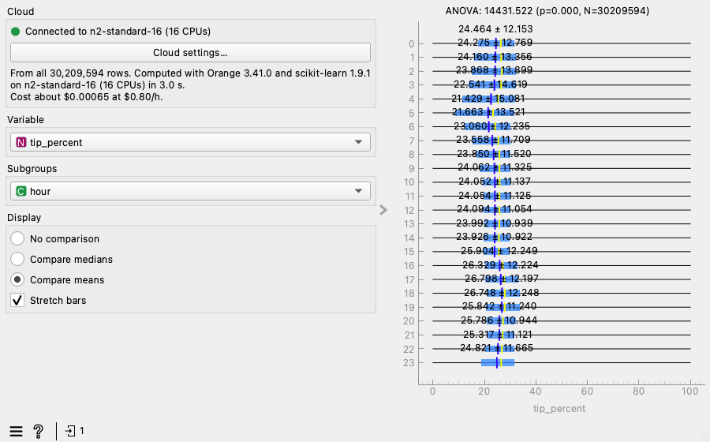
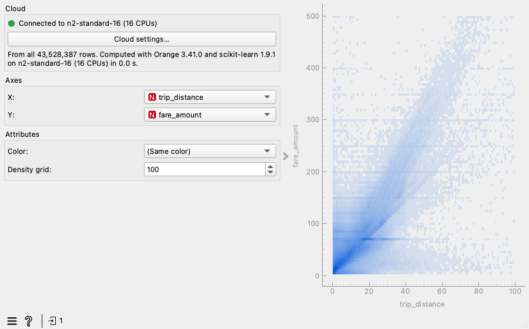
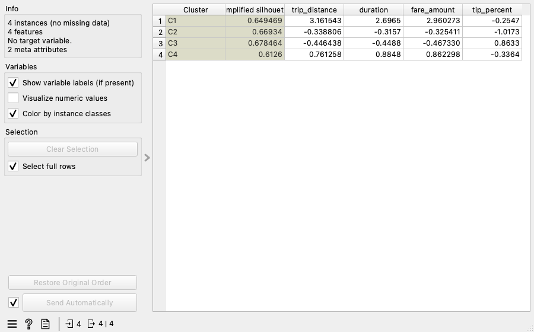
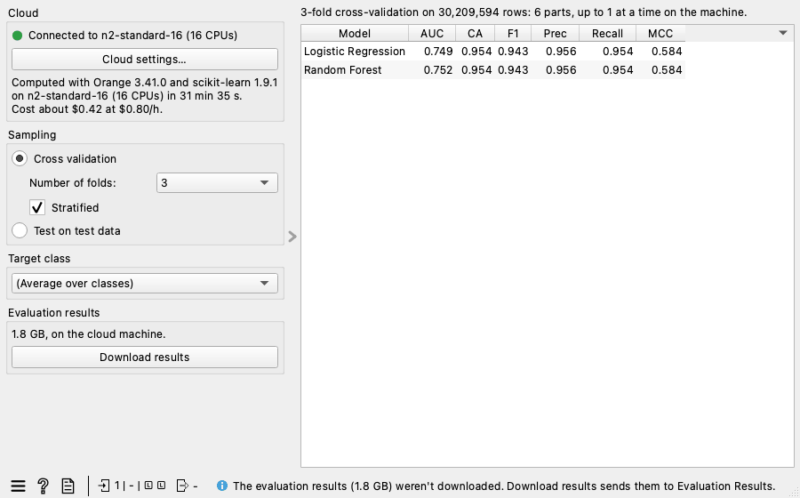

# NYC taxi demo: a year of trips

`examples/taxi-demo.ows` explores and models every yellow taxi trip in New York City in 2025, about 48.7 million of them, on a cloud machine: when people tip and how much, how distance and fare go together, what kinds of trips there are, and whether a trip paid by card gets a tip. Orange's own widgets change the data (Feature Constructor, Select Rows, Select Columns), and Cloud widgets look at it and compute on it, all on all rows.

The data is the trip records of the [NYC Taxi and Limousine Commission](https://www.nyc.gov/site/tlc/about/tlc-trip-record-data.page) (TLC): twelve monthly Parquet files, 0.8 GB together. Orange's File widget can't read Parquet; as CSV, the year is 4.2 GB, and Orange on a laptop with 16 GB of memory can't load it. On a Medium cloud machine the whole workflow takes about 45 minutes and costs about $0.60.



## Run it

1. Open the workflow: `scripts/run-orange.sh examples/taxi-demo.ows`, or File → Open in Orange.
2. In any Cloud widget, click "Cloud settings…", choose your cloud (Google Cloud, AWS or Azure; see the [README](../README.md#choose-a-cloud)) and the size Medium (16 vCPUs, 64 GB) or larger, and click Start.
3. When the machine is connected, Cloud File makes it read the twelve files from the TLC's site itself: its URL, `https://d37ci6vzurychx.cloudfront.net/trip-data/yellow_tripdata_2025-{01..12}.parquet`, names the twelve months with a numbered pattern, and the machine loads them one after the other as one table. Nothing goes through your computer.
4. Everything after Cloud File runs by itself. Each Cloud widget shows how long the machine computed and what it cost.
5. Stop the machine in Cloud settings when you're done. Otherwise it stops by itself after the idle timeout.

On a Small machine (4 vCPUs, 16 GB), for example while your account's vCPU quota doesn't allow Medium, open `examples/taxi-demo-january.ows` instead: the same workflow on one month, `…/yellow_tripdata_2025-01.parquet` (3.5 million trips). On a Small machine on Azure (`Standard_D4s_v6`), it took 3 minutes after the machine had started (in 1.5 minutes), about $0.02 in all.

Cloud File keeps its column settings (the codes made categorical, the skipped columns) only for the URL they were made for. If you change the URL yourself, set them again in Cloud File's Columns. Otherwise Select Columns passes on other columns too: the model would get `total_amount`, for example, which includes the tip.

## What it does

- **Cloud File** reads the trips. The pickup and drop-off zones (`PULocationID`, `DOLocationID`), the vendor, the rate code and the payment type are codes, so the workflow makes them categorical in Cloud File's column list. Seven money columns that the workflow doesn't use are skipped (extra, MTA tax, tolls, improvement surcharge, total amount, congestion pricing fee and the store-and-forward flag), which saves memory.
- **Feature Constructor** (Orange's own widget, called Formula in Orange 3.41's toolbox) adds five columns: the pickup `hour` and `weekday` (categorical), the `duration` in minutes, the tip as a percentage of the fare (`tip_percent`, missing when the fare isn't positive), and whether there was a tip (`tipped`). The trip records keep local New York time, so the hour is the hour of the day in New York.
- **Possible Trips**, Orange's Select Rows, keeps trips of 1 to 180 minutes, 0.1 to 100 miles, a fare of $3 to $500, and a tip of 0 to 100 % of the fare. It drops 11 % of the year's trips (5.2 million): negative fares, trips that end before they start, zero distances, and the like.
- **Tips by Payment Type** (Cloud Distributions) shows the tip percentage of each payment type: cash tips aren't recorded, so cash trips show no tips. The rest of the workflow uses the trips paid by card (**Card Trips**, Select Rows).
- **Distance and Fare** (Cloud Scatter Plot) draws the density of all trips: most follow the meter's line, and the flat airport fares (JFK) stand out as a horizontal line.
- **Tips by Hour** and **Tips by Weekday** (Cloud Box Plot) show the tip percentage of card trips by the hour and the day.
- **Cloud k-Means** clusters the trips by distance, duration, fare and tip percentage (normalized, k = 4) into kinds of trips; **Kinds of Trips**, Orange's Data Table, shows the clusters' centres, in standard deviations from the mean, as Orange's k-Means gives them. In 2025 they are long trips (such as to the airports), medium trips, short trips with a generous tip, and short trips with little or no tip.
- **Cloud Test & Score** cross-validates (3 folds) Logistic Regression and Random Forest on whether a card trip gets a tip, from the hour, weekday, distance, duration, fare, number of passengers, rate code, vendor, and airport and congestion fees. Logistic Regression has Orange's default settings; Random Forest too, except that its trees are at most 12 levels deep: on millions of rows, fully grown trees take more time and memory and predict worse (AUC 0.68 instead of 0.72 on January).











The zones stay numbers (as categories): the TLC's [zone lookup table](https://d37ci6vzurychx.cloudfront.net/misc/taxi_zone_lookup.csv) has their names and boroughs, and Orange's own widgets could add them on cloud data (Edit Domain renames categories, Feature Constructor can map a zone to its borough), but 265 names by hand would make the workflow hard to read.

## Timings

Laptop: MacBook Pro M1 (8 cores), 16 GB, macOS 26, Orange 3.41.0, with other apps open as usual. The laptop numbers are what Orange's own widgets do with the same settings: File reads a CSV of the first months (Orange can't read Parquet; the CSV has Orange's three header rows, so the zones and codes are categorical, as one would set them in File, and the skipped columns aren't in it), and Feature Constructor, Select Rows, Distributions, Scatter Plot, Select Columns, k-Means, Box Plot and Test & Score run one after the other in one Orange process, each keeping its data, as in Orange's canvas. A run counts as out of memory when the system's swap grows by more than 8 GB; a step that took over an hour would be stopped.

Cloud: Medium on Google Cloud (`n2-standard-16`, 16 vCPUs, 64 GB) in `us-central1`, at $0.80 an hour, running the workflow above on all of 2025, as a user does. The times are how long each step computed on the machine.

| | Laptop, January | Laptop, 2 months | Laptop, 4 months | Laptop, the year | Cloud, Medium, the year |
|---|---:|---:|---:|---:|---:|
| Trips | 3.5M | 7.1M | 15.2M | 48.7M | 48.7M |
| Load (File, Cloud File) | 49 s | 1 min 40 s | 4 min 20 s | **out of memory**: stopped after 7 min | 47 s |
| Feature Constructor and Select Rows | 10 s | 18 s | 40 s | – | 7 min 18 s |
| Distributions | 3 s | 6 s | 13 s | – | 3 s |
| Scatter Plot | 27 s | 55 s | 2 min 15 s | – | 6 s |
| k-Means | 6 s | 10 s | 21 s | – | 1 min 58 s |
| Card Trips and the Box Plots | 2 s | 4 s | 10 s | – | 8 s |
| Test & Score (3 folds) | 1 min 44 s | 3 min 25 s | 9 min 8 s | – | 31 min 35 s |
| All steps | 3 min 23 s | 6 min 42 s | 17 min 11 s | – | 41 min 55 s |
| Memory | no swap | no swap | 5.1 GB of swap | 8.7 GB of swap | 49 of 64 GB |
| AUC: logistic regression / forest | 0.715 / 0.719 | 0.713 / 0.718 | 0.711 / 0.715 | – | 0.749 / 0.752 |

On the cloud machine, starting it took 74 s and the whole workflow 42 minutes: every view of the 48.7 million trips, from Cloud File to the box plots, was ready after 10.5 minutes, and the cross-validation took the other 31.5. The machine ran for 44.5 minutes in all, about $0.59: Feature Constructor and Select Rows cost $0.10, k-Means $0.03, Test & Score $0.42, and each of the other steps less than a cent. Each Cloud widget shows its own time and cost.

What this shows:

- **The laptop can't hold the year.** Four months (15 million trips) already make the 16 GB Mac swap 5 GB, and the year runs out of memory before File has loaded it.
- **The cloud machine looks at every trip in seconds.** It loads the year in 47 s, and its viewers compute on 43.5 million trips in 2–6 s each, about as fast as the laptop draws one month.
- **Feature Constructor is the slow step on the machine.** Orange computes its expressions row by row in Python, on one core, and the machine checks the new categorical columns once more on all rows, so the five new columns took 7 minutes. It runs once for all four branches of the workflow.
- **Cross-validation runs one part at a time on a Medium machine.** Each part (a learner on two thirds of the 30.2 million card trips) needed 23–27 GB of memory, so the six parts ran one after another; a machine with more memory runs them side by side. Logistic regression took 20 minutes of the 31, the forest 4.
- **The year gives a better model.** Both learners reach an AUC of 0.75 on the whole year, against 0.71–0.72 on its first months.

## The data

The trip records are published by the TLC on its [trip record data page](https://www.nyc.gov/site/tlc/about/tlc-trip-record-data.page), and are also part of NYC Open Data. New York City's Open Data law makes public data sets available "without any registration requirement, license requirement or restrictions on their use" (NYC Administrative Code § 23-502(d)). The TLC notes that the trip data was not created by the TLC, which makes no representations as to its accuracy. The files have been at the same addresses since the TLC moved them to Parquet in May 2022; the TLC says the schema may still change a little, to make it the same across years.

The 2025 files have 20 columns; from 2025 on, `cbd_congestion_fee` holds the Manhattan congestion pricing fee. Older years differ a little: some columns are 64-bit instead of 32-bit numbers, `airport_fee` is spelled in lower case, and there is no congestion fee. Cloud File loads such files together (see "Several files as one table" in its help page); `…/yellow_tripdata_{2024,2025}-{01..12}.parquet`, for example, names two years.

`TestRealTaxi` in `tests/test_taxi_demo.py` runs the workflow as a user would, on any of the three clouds, and checks every widget's result:

```sh
set -a; source .orange3-cloud-dev.env; set +a
ORANGE3_CLOUD_TAXI=gcp .venv/bin/pytest tests/test_taxi_demo.py -k test_taxi_on_cloud -s
```

With `ORANGE3_CLOUD_TAXI=aws` or `azure`, it runs on a Small machine with January only (`ORANGE3_CLOUD_TAXI_MONTHS` and `ORANGE3_CLOUD_TAXI_MACHINE` change that).
