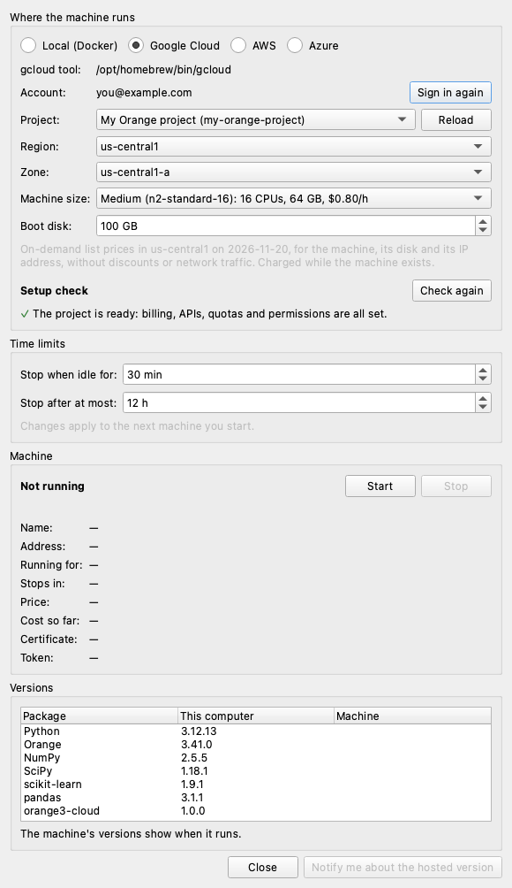

# Setting up Google Cloud

The add-on starts machines in your own Google Cloud project. This guide sets up that project once, and takes about 15 minutes. Orange checks the project for you and says what is still missing, so you can also start at step 4 and come back here when the check asks for something.

You need:

- a Google account,
- a payment method for Google Cloud billing (a credit card or a bank account, depending on your country),
- Orange with the `orange3-cloud` add-on (see the [README](../README.md)).

## 1. A project with billing

1. Open the [Google Cloud console](https://console.cloud.google.com) and sign in with your Google account. The first time, accept Google Cloud's terms.
2. **Create a billing account** if you don't have one: **Billing** in the console's menu, then **Create account** (or **Start free** for Google's free trial). New accounts often get free trial credit.
3. **Create a project**: the project list at the top of the console, then **New project**. Give it a name, for example "Orange cloud". Google gives it a project ID such as `orange-cloud-123456`.
4. **Link the project to the billing account**: **Billing** → **Link a billing account** while the project is selected.

**Free trial accounts:** during Google's free trial, the number of vCPUs that can run at the same time is limited, so only the Small machine size runs. For Medium and larger sizes, upgrade the billing account to a paid account (**Billing** → **Upgrade**). Your trial credit stays.

## 2. A budget alert

The add-on stops idle machines and shows what each job cost, but it has no spending limit of its own. A budget alert emails you when the month's costs reach an amount you choose:

1. In the console, open **Billing** → **Budgets & alerts** → **Create budget**.
2. Choose your project, an amount (for example $20 a month) and the alert thresholds (for example 50%, 90% and 100%).

An alert doesn't stop anything: it only sends an email.

## 3. The `gcloud` tool

The add-on signs in to Google Cloud with Google's `gcloud` command-line tool.

1. Install the Google Cloud CLI as [Google's instructions](https://cloud.google.com/sdk/docs/install) describe. On a Mac with Homebrew, `brew install --cask google-cloud-sdk` works too.
2. You don't need to run `gcloud init`. Orange finds `gcloud` in the usual install folders and on your shell's `PATH`, even when Orange is started from the Dock.

## 4. Sign in from Orange

1. Open any Cloud widget, for example Cloud File, and click **Cloud settings…**.
2. Choose **Google Cloud**.
3. Click **Sign in with Google**. Your browser opens Google's sign-in page. Sign in and allow access. Back in Orange, the dialog shows your account.

   This runs `gcloud auth application-default login`, which stores the sign-in on your computer, where Google's tools keep it. You can also run that command in a terminal.

4. Choose your **project**, a **region** and a **zone**. Choose a region near you or near your data, for example `us-central1`, `europe-west4` or `asia-east1`. Prices differ a little between regions. The dialog shows only the zones that are up. In a new project, the regions are listed once the Compute Engine API is on: the dialog says so, and **Enable APIs…** in the setup check (step 5) turns it on.



## 5. The setup check

Below the project, the dialog checks everything a machine needs and shows what is missing, with a link to the right page of the console. When everything passes, it shows one line, "The project is ready".

| Check | What to do if it fails |
|---|---|
| Signed in, a project chosen | Click **Sign in with Google** and choose a project. |
| Billing enabled | Link the project to a billing account (step 1). |
| Compute Engine and Cloud Storage APIs | Click **Enable APIs…**. Orange asks first, then enables them, which takes a minute or two, and lists the regions. |
| CPU quota in the region | Each machine family has a quota of vCPUs per region. If it's too low, choose a smaller size or another region, or request more (see below). |
| Global CPU quota (`CPUS_ALL_REGIONS`) | New projects often have a low global quota. Request more (see below). |
| Permissions | You need to manage machines, firewall rules and storage buckets in the project. The project's owner has these permissions. Otherwise ask the owner for the Editor role, or for Compute Admin, Storage Admin and Service Account User. |

**Requesting more quota:** the check links to the console's quota page. Filter for the quota it names (for example `CPUS_ALL_REGIONS`, or `N2_CPUS` in your region), select it, click **Edit quotas**, and ask for at least the number of vCPUs the check says. Small requests are often approved within minutes, but it can take longer. Medium needs 16 vCPUs, Large 32.

## 6. Machine size and limits

**Machine size** lists the sizes your zone offers, with their hourly list price in your region. Cloud File suggests a size that fits the file you load ("fits your data").

| Size | vCPUs | Memory | Price in `us-central1` |
|---|---:|---:|---:|
| Small (testing) | 4 | 16 GB | $0.15/h |
| Medium (default) | 16 | 64 GB | $0.80/h |
| Medium, high memory | 16 | 128 GB | $1.07/h |
| Large | 32 | 128 GB | $1.57/h |
| Large, high memory | 32 | 256 GB | $2.11/h |
| Extra large | 64 | 256 GB | $2.72/h |
| Extra large, high memory | 64 | 512 GB | $4.21/h |
| Huge | 88 | 352 GB | $4.45/h |
| Huge, high memory | 128 | 864 GB | $7.73/h |

The prices are Google's on-demand list prices of November 2026, with a 100 GB boot disk and the machine's IP address included. Discounts, network traffic and storage aren't included.

As a rule of thumb, a table needs about 8 bytes per value in memory (rows × columns × 8), and learning needs several times that. For example, the 11 million rows and 29 columns of the HIGGS dataset take about 2.5 GB, and cross-validating a random forest on them works well on Medium.

- **Boot disk:** 100 GB by default, from 50 to 2000 GB. The disk holds the downloaded files, Python and your packages. Make it larger for big files from URLs.
- **Stop when idle for:** 30 minutes by default. The machine stops when no job has run and no Cloud widget has asked it for anything for this long. If it hasn't heard from Orange at all for this long, for example because Orange crashed or the laptop slept, it also cancels its jobs, which nobody is waiting for.
- **Stop after at most:** 12 hours by default, even while it works.

These apply to the next machine you start.

## 7. Start a machine

Click **Start**. The dialog shows the steps:

1. allowing your computer's IP address through the firewall (the rule `orange3-cloud-https`),
2. creating the machine `orange3-cloud-<id>`,
3. downloading the machine image,
4. installing Python, Orange and your packages at your exact versions,
5. starting the server.

It usually takes about two minutes. Then the Cloud widgets say "Connected", and the dialog shows the machine's price, its cost so far and the time until it stops.

If you close Orange, the Cloud widgets cancel their jobs, and the machine keeps running until its idle time is over. When you open Orange again while it runs, Orange connects to it again.

## 8. Your files in the storage bucket

When Cloud File loads a file from your computer for the first time, it asks to create a storage bucket in your project, `orange3-cloud-<project>-<random>`, in the machine's region. It uploads the file there and the machine loads it from the bucket. Uploads continue where they stopped if the connection breaks.

Files stay in the bucket, so loading the same file in a later session doesn't upload it again. Storage costs about $0.02 per GB a month. **Uploaded files…** in Cloud File lists them and deletes the ones you check. Deleting a file doesn't affect tables already loaded on a running machine.

Files at `https://` URLs and in your own buckets (`gs://...`) are loaded by the machine directly and don't go through your computer. The machine reads `gs://` files as your project's default Compute Engine service account, so that account needs read access to them.

## 9. Stop, and check that nothing is left

- **Stop** in Cloud settings deletes the machine, its disk, and the firewall rule.
- A machine also stops by itself after the idle time or the maximum lifetime. If Orange is open then, Orange deletes it. If Orange was closed, the machine is powered off but its disk stays until you open Orange again, which deletes it.
- If Orange quits while a machine is starting, the machine may be left behind. Cloud settings lists such machines with a **Delete them…** button.

To check yourself, open **Compute Engine → VM instances** in the console and look for machines named `orange3-cloud-…`, or run:

```sh
gcloud compute instances list --project=YOUR_PROJECT --filter=labels.orange3-cloud=true
gcloud compute firewall-rules list --project=YOUR_PROJECT --filter=name=orange3-cloud-https
```

All the add-on's machines have the label `orange3-cloud=true`, so you can also find them in billing reports.

## Troubleshooting

- **"gcloud wasn't found"**: install the Google Cloud CLI (step 3) and open Cloud settings again.
- **"Not signed in"** or a sign-in that stopped working: click **Sign in with Google** (or **Sign in again**).
- **Region and Zone stay empty in a new project** (version 1.0.0): click **Check again**, then **Enable APIs…**, then **Reload**. Fixed in 1.0.1.
- **A quota check fails**: choose a smaller size or another region, or request more quota (step 5). On a free trial account, upgrade it.
- **The machine doesn't connect**: your IP address may have changed, or a VPN or company network may block port 8443. The add-on updates the firewall rule when your address changes; try again after leaving the VPN. The dialog's messages show where the start stopped.
- **"Not enough memory"** or a warning in Cloud File: choose a larger size. Cloud File's estimate suggests one.
- **A package failed to install on the machine**: Cloud settings lists the versions on your computer and on the machine, and the packages that couldn't be installed. Packages installed from a folder on your computer can't be copied.

## Remove everything

To remove everything the add-on created in your project:

1. Click **Stop** in Cloud settings, and **Delete them…** if it lists machines left behind.
2. Delete your uploaded files with **Uploaded files…** in Cloud File, or delete the bucket `orange3-cloud-…` in the console's **Cloud Storage → Buckets**.
3. Delete the firewall rule `orange3-cloud-https` if it's still there (**VPC network → Firewall**).

Or delete the whole project in the console (**IAM & Admin → Settings → Shut down**), which removes everything in it.
